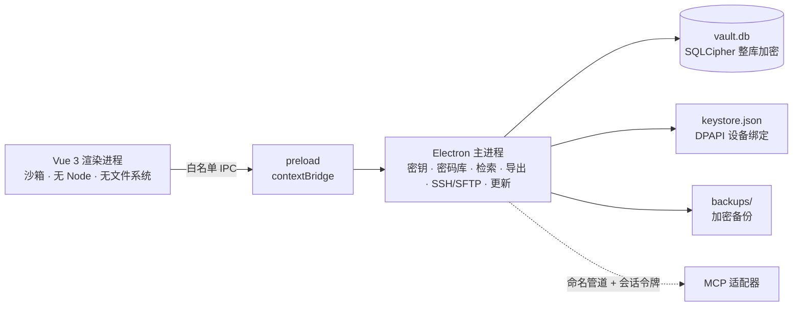
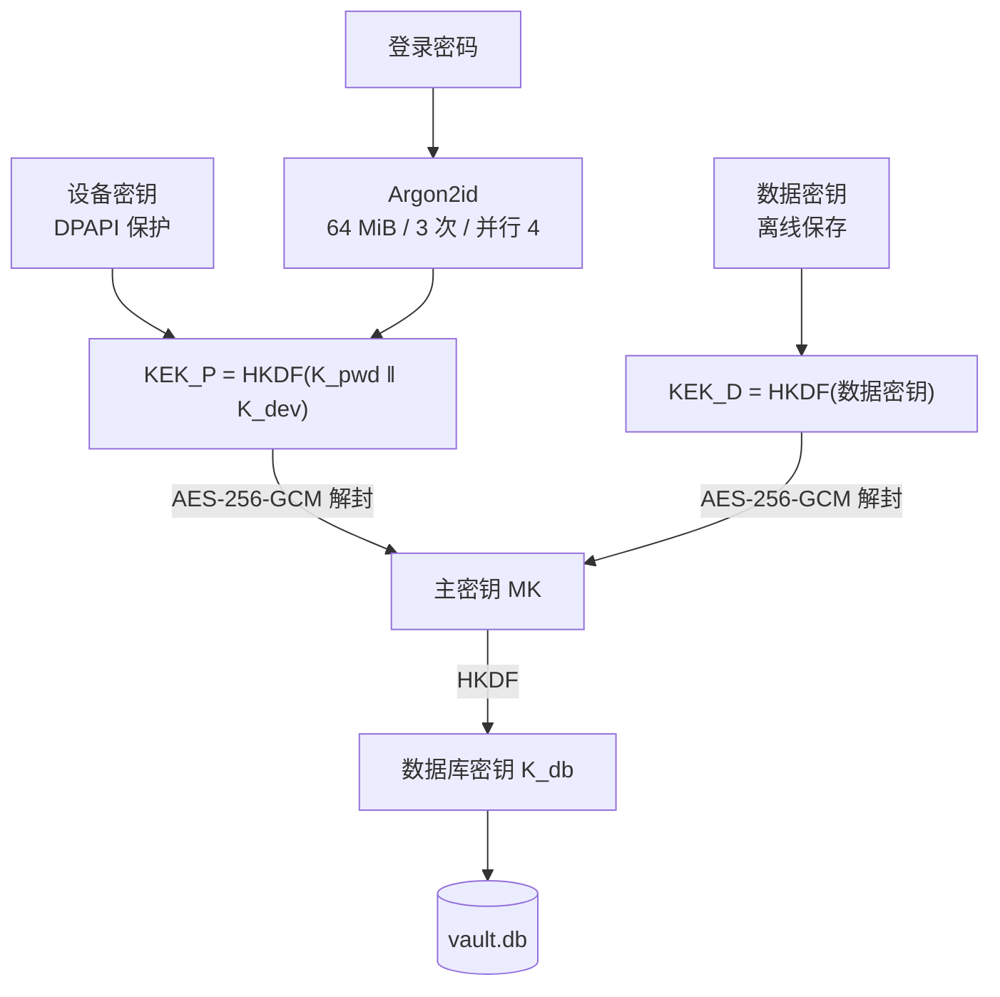

# Stay

> 个人密码与账号管理工具 · Windows 桌面 · 单用户 · 纯本地加密
>
> 源码仓库为私有；本仓库只承载**发布说明、使用手册与安装包**，不包含源代码、密钥或用户数据。

Stay 把账号密码、服务地址、运维信息与 Markdown 文档集中存放在一个**加密的本地数据库**里。它不依赖任何云服务，不需要注册账号，也不做遥测。整个数据文件夹可以被整体拷走，但离开这台电脑之后，没有数据密钥就无法解开。

---

## 目录

1. [设计理念](#1-设计理念)
2. [功能总览](#2-功能总览)
3. [安全模型](#3-安全模型)
4. [安装](#4-安装)
5. [首次使用](#5-首次使用)
6. [日常使用](#6-日常使用)
7. [SSH 终端与 SFTP](#7-ssh-终端与-sftp)
8. [导出、备份与迁移](#8-导出备份与迁移)
9. [MCP 本地集成（高级）](#9-mcp-本地集成高级)
10. [设置项](#10-设置项)
11. [快捷键](#11-快捷键)
12. [数据与文件位置](#12-数据与文件位置)
13. [版本更新](#13-版本更新)
14. [故障排查](#14-故障排查)
15. [常见问题](#15-常见问题)
16. [安全边界与已知限制](#16-安全边界与已知限制)
17. [发布资产与校验](#17-发布资产与校验)
18. [版本与兼容性](#18-版本与兼容性)
19. [隐私声明](#19-隐私声明)
20. [反馈与维护](#20-反馈与维护)

---

## 1. 设计理念

### 1.1 本地优先，数据属于自己

Stay 不是“带本地缓存的云密码库”，而是**从设计第一天就只存在于本机**的工具：

- 没有账号体系，没有服务端，没有同步协议；
- 所有条目、字段、Markdown 正文、图片附件、检索索引都在一个加密的 SQLite 文件里；
- 断网可以完整使用；
- 迁移靠“拷贝一个文件夹 + 数据密钥”，而不是登录某个平台。

### 1.2 加密是默认，不是选项

加密不是设置里的开关，而是数据存在的前提：

- 数据库整库加密（SQLCipher），磁盘上不存在明文条目；
- 登录密码通过 Argon2id 慢速派生，刻意增加暴力尝试成本；
- 主密钥使用 AES-256-GCM 封装；
- 设备密钥由 Windows DPAPI 保护，把日常登录绑定到“本机 + 本账户”；
- 锁定时关闭数据库并清零内存中的密钥缓冲区。

### 1.3 两把钥匙，没有后门

Stay 使用两条互相独立的恢复路径：

- **登录密码**：日常解锁，配合本机设备密钥使用；
- **数据密钥**：256 位随机值，用于换电脑、重装系统、更换 Windows 账户或忘记登录密码。

登录密码与数据密钥**同时丢失**时，数据无法恢复。这是加密设计的必然结果，不是缺陷。软件不保存密码，也不存在万能恢复入口。

### 1.4 显式信任边界

界面进程被视为不可信：

- 界面运行在沙箱中，不能访问 Node、文件系统或数据库；
- 只能调用白名单 IPC，入参在主进程做类型与范围校验；
- **密码类字段默认遮蔽**，只有用户主动“显示”时才单独请求；
- 复制密码由主进程写剪贴板，界面拿不到明文；
- MCP 工具永远不会返回密码类字段的明文；
- 导出明文、打开外部链接、使用 MCP 都需要用户显式动作。

### 1.5 找得快，一层可达

三栏布局 + 标签页 + 全局检索：

- `Ctrl+K` 在任意位置检索标题、非密码字段、标签、目录与 Markdown 正文；
- 回车打开，`Ctrl+U` / `Ctrl+P` 直接复制用户名 / 密码；
- 常用操作都在一层菜单内，不做多级嵌套；
- 每个条目可以有自己的标签页与 SSH 会话，切换标签不会断开连接。

### 1.6 可搬走，也可恢复

- 整个数据目录可以拷贝到 U 盘；
- 每日首次解锁自动备份，恢复前先备份当前数据；
- 回收站保留 30 天，误删可恢复；
- 数据导入先复制到暂存目录，校验通过才替换，失败自动回滚。

### 1.7 克制的功能边界

Stay 明确**不做**：

- 多用户、权限、共享、团队协作；
- 云同步、多设备自动同步、双向合并；
- 浏览器自动填充、手机端；
- 界面内注册或新增用户。

这些不是“以后再说”，而是为了保持攻击面、数据模型与使用方式足够小。

---

## 2. 功能总览

| 模块 | 能力 |
| --- | --- |
| 加密保险库 | SQLCipher 整库加密；Argon2id + DPAPI 设备绑定；AES-256-GCM 密钥封装 |
| 信息组织 | 级联目录、内置与自定义分类、标签、收藏、最近使用、回收站 |
| 条目与字段 | 文本 / 密码 / 网址 / 多行文本四类字段；自定义字段模板；密码生成器 |
| 检索 | FTS5 trigram 全文检索；1–2 字短词回退；密码字段永不入索引 |
| Markdown | 编辑 / 分屏 / 预览；工具栏与快捷键；1 秒自动保存；图片粘贴入加密库 |
| 导出 | 按条目 / 目录子树 / 整库；单文件或保留层级；可选 Front Matter、附件、zip |
| 备份与迁移 | 每日自动备份、手动备份、恢复前备份；数据密钥导入向导 |
| 标签页 | 多条目并行打开；每标签独立 SSH 会话；可记忆的侧栏宽度；左侧栏可收起 |
| 主题 | 7 套低饱和主题（5 浅色 + 2 深色），界面与终端同步 |
| SSH | 直连、经堡垒机转发、堡垒机菜单登录；TOTP 自动登录；重连；最多 4 个独立分屏；锁库即断开 |
| SFTP | 浏览、上传、下载、新建目录、重命名、删除；进度显示；复用 SSH 连接；同名覆盖确认；分屏时选择挂载终端 |
| 快捷键 | 全部动作可自定义；同区域冲突检测；单条或全部恢复默认 |
| MCP | 本机命名管道 + 会话令牌；13 个工具；密码只写不读 |
| 更新 | GitHub Releases 在线更新；手动选择安装包；升级不动数据 |

---

## 3. 安全模型

### 3.1 架构



### 3.2 密钥体系



由此得到三个性质：

1. **日常登录 = 登录密码 + 本机。** 数据文件夹被拷到别的电脑或别的 Windows 账户，即使知道登录密码也打不开。
2. **迁移与恢复 = 数据密钥。** 数据密钥是真随机的 256 位值，不依赖密码强度。
3. **改密码、换数据密钥不需要重新加密数据。** 只重写 `keystore.json` 中对应的密钥槽。

### 3.3 静态数据

| 文件 | 内容 | 是否明文 |
| --- | --- | --- |
| `vault.db` | 条目、字段、Markdown、附件、目录、标签、检索索引 | 否，SQLCipher 整库加密 |
| `keystore.json` | 盐值、KDF 参数、被封装的主密钥、DPAPI 保护的设备密钥 | 明文 JSON，但单独拿到无法解密 |
| `backups/*.db` | 数据库备份 | 否，同样是加密库 |
| `backups/keystore-*.json` | 对应时期的密钥文件 | 明文 JSON，受 DPAPI 绑定 |
| `user.json` | 用户名；初始化前可能含初始密码 | 初始化完成后立即删除初始密码 |
| `settings.json` | 主题、窗口位置、安全设置等非敏感配置 | 是 |
| `logs/main.log` | 操作类型与错误信息，不含字段值、密码或密钥 | 是 |

### 3.4 运行时防护

- 密码类字段默认遮蔽，切换条目后自动恢复遮蔽；
- 显示密码需要单独 IPC 请求，离开详情页即失效；
- 复制密码由主进程完成，到时清除且只清除“仍是当初那段内容”的剪贴板；
- 空闲自动锁定（默认 5 分钟）、系统锁屏 / 休眠联动锁定；
- 默认禁止窗口被截屏与屏幕共享捕获；
- 单实例运行，避免两个进程同时写数据库；
- 生产环境启用 CSP，禁用开发者工具，拒绝全部权限请求；
- Markdown 渲染净化，禁止加载远程图片，外链二次确认。

### 3.5 密码字段如何被隔离

- 列表与详情接口返回的密码字段值是空字符串；
- 全文检索索引不包含密码字段；
- 编辑条目时，密码字段留空表示“保持原值”，不会误清空；
- SSH / SFTP 的密码由主进程直接从加密库读取，不下发到界面进程；
- MCP 工具不会返回密码明文，也不能通过检索间接读到密码。

---

## 4. 安装

### 4.1 系统要求

| 项 | 要求 |
| --- | --- |
| 操作系统 | Windows 10 / 11 x64 |
| 磁盘 | 安装包约 100 MB 量级，另需数据目录空间 |
| 网络 | 仅更新检查与在线下载需要；日常使用可完全离线 |

普通用户不需要安装 Node.js、Python 或数据库。安装包是自包含的。

### 4.2 安装步骤

1. 打开本仓库的 **Releases** 页面；
2. 下载 `Stay-Setup-<版本>.exe`；
3. 双击安装，选择安装目录；
4. 首次运行时 Windows 可能提示“未知发布者”（当前安装包未做代码签名），确认来源与校验值后再继续；
5. 启动 Stay。

### 4.3 安装范围

- 安装程序只替换程序文件，**不触碰数据目录**；
- 数据默认放在**安装目录**下的 `data\`（例如 `D:\Apps\Stay\data`）；安装目录不可写时（如安装在 Program Files）自动回退到 `%APPDATA%\Stay\data`；
- 升级与卸载都会保留该 `data\` 文件夹；需要换位置时，用“设置 › 数据与迁移 › 更改目录…”整体迁移；
- `%APPDATA%\Stay` 下保存设置与日志，卸载同样保留；
- 升级安装前建议先在“设置 › 数据与迁移”中手动备份一次。

### 4.4 当前发布形态

| 形态 | 状态 |
| --- | --- |
| NSIS 安装版（推荐） | 当前发布 |
| 免安装 / 便携版 | 计划中，后续版本提供 |
| 内网更新源（Nginx） | 预留，尚未提供 |

---

## 5. 首次使用

### 5.1 准备用户配置

Stay 不提供界面内注册。首次启动时，如果数据目录中没有用户配置，会显示“未检测到用户配置”。

点击“生成模板文件”，或在数据目录中手动创建 `user.json`：

```json
{
  "username": "demo-user",
  "initialPassword": "请替换为至少 8 位的强初始密码"
}
```

说明：

- `username` 只用于界面显示与日志，不参与加密；
- `initialPassword` 只用于首次初始化，**初始化完成后会立即从文件中删除**；
- 建议使用 12 位以上、包含大小写与符号的密码；
- 不要把 `user.json` 放进网盘或代码仓库。

### 5.2 初始化

点击“重新检测”后，程序会：

1. 生成主密钥、设备密钥、数据密钥（均为 256 位随机值）；
2. 用“登录密码 + 设备密钥”封装主密钥；
3. 用数据密钥封装主密钥；
4. 创建加密数据库并写入内置分类；
5. 从 `user.json` 中删除明文初始密码；
6. 展示一次性的**数据密钥**，要求输入最后一组确认已保存。

### 5.3 保存数据密钥

数据密钥显示为 **11 组 × 5 个字符**，使用 Crockford Base32：

- 不含 `I`、`L`、`O`、`U`，避免与数字混淆；
- 带 CRC-16 校验，抄错一个字符能当场发现；
- 输入时不区分大小写，自动忽略空格与连字符；
- `I` / `L` 视为 `1`，`O` 视为 `0`。

请用以下方式之一离线保存：

- 抄写在纸上；
- 打印后存放；
- 保存到不联网的离线介质。

**不要**把数据密钥与数据文件夹放在同一位置，也不要放进网盘、聊天软件或密码库本身。

### 5.4 登录与锁定

初始化完成后进入登录页。之后每次启动只需输入登录密码。

锁定方式：

- `Ctrl+L` 手动锁定；
- 空闲超时自动锁定（默认 5 分钟）；
- Windows 锁屏或休眠时锁定；
- 关闭窗口时按设置退出或最小化到托盘；
- 从托盘菜单选择“立即锁定”。

锁定时会关闭数据库、清零内存中的密钥缓冲区，并断开全部 SSH / SFTP 会话。

---

## 6. 日常使用

### 6.1 主界面

界面分为三栏：

- 左侧：目录树、分类、标签、收藏、最近使用、回收站；
- 中间：当前范围内的条目列表；
- 右侧：标签页工作区（详情、编辑、Markdown 文档、SSH 终端、SFTP 面板）。

侧栏与列表之间的分隔条可以拖动，宽度会被记住。左侧栏（目录侧边栏与条目列表）可以一起收起（标题栏左侧按钮或 `Ctrl+B`），让工作区占满宽度；收起状态和两列宽度都会记住，在 SSH 终端里按 `Ctrl+B` 仍交给 shell。

### 6.2 目录、分类与标签

**目录**支持任意层级：

- 新建、重命名、移动、删除；
- 同一父目录下不允许重名；
- 不允许把目录移动到自身或其子目录；
- 删除目录时，其中的条目进入回收站，不会直接销毁。

**分类**用于描述条目类型：

| 内置分类 | 类型 | 默认字段 |
| --- | --- | --- |
| 账号密码 | 普通条目 | 用户名、密码、登录地址 |
| 服务地址 | 普通条目 | 地址、端口（默认 22）、所属环境、用户名、密码 |
| Markdown 文档 | 文档 | 无字段，正文为 Markdown |

也可以新建自定义分类，设置名称、颜色、图标与默认字段模板。

**标签**用于跨目录、跨分类的横向归类；输入不存在的标签会自动创建。

左侧的标签可以**多选**：单击选中，再次点击取消；选中多个时只列出**同时带有这些标签**的条目（且的关系），全部取消后回到「全部条目」。列表标题显示「已选 N 个标签」，悬停可查看完整标签。多选状态会随上次位置一起恢复。

重新启动后会回到上次查看的条目（标签页与右侧详情一起恢复），左侧目录只展开该条目所在的目录链，其余目录保持收起。

### 6.3 条目与字段

新建条目时填写标题、分类、目录、标签与字段。字段分四类：

| 类型 | 用途 | 展示方式 |
| --- | --- | --- |
| 文本 | 用户名、IP、端口等 | 直接显示 |
| 密码 | 密码、令牌、密钥 | 默认遮蔽，按需显示 |
| 网址 | 登录地址、控制台地址 | 可点击，确认后用系统浏览器打开 |
| 多行文本 | 连接串、证书、长命令 | 多行代码块展示 |

编辑条目时：

- 密码字段留空表示“保持原值”；
- “复制并新增”会以当前条目为模板创建副本，密码由主进程继承，不经过界面；
- 副本标题自动加“副本”后缀，并在同一目录内查重。

### 6.4 密码生成器

新建或编辑密码字段时可打开密码生成器：

- 长度 8–64；
- 大写、小写、数字、符号可独立开关；
- 使用系统密码学随机源；
- 保证每个勾选的字符集至少出现一次；
- 生成后可直接填入字段。

### 6.5 检索

`Ctrl+K` 打开全局检索：

- 覆盖标题、非密码字段、标签、目录路径与 Markdown 正文；
- 密码字段**永远不进入索引**；
- 3 个字符以上走 FTS5 trigram；1–2 个字符自动回退到 LIKE；
- 结果显示高亮片段；
- `Ctrl+U` 复制用户名，`Ctrl+P` 复制密码；
- `Enter` 打开条目，`Esc` 关闭检索。

### 6.6 Markdown 文档

“Markdown 文档”分类下的条目使用文档视图：

- 编辑 / 分屏 / 预览三种模式；
- 工具栏与快捷键；
- 行号、停止输入 1 秒后自动保存；
- 支持表格、代码块、引用、列表、删除线与 `==高亮==` 文本块；
- 高亮可选中文字后点工具栏 **H** 或按 `Ctrl+Shift+H` 插入；
- 字号在 **设置 › 通用 › 界面显示 › Markdown 字号**（12–20 px），标题、代码与表格按比例缩放；
- 编辑时可选中文字，用工具栏的**字号**下拉单独设置 12–28 px，插入 `[size=18]文字[/size]`；
- 代码块右上角有「复制」按钮，行内代码点击即复制；
- 「编辑信息」可修改标题、分类、目录与标签；切换前会先保存当前正文；
- 图片可粘贴、拖入或选择文件，单张上限 10 MB，存入加密库；
- 不加载远程图片，外链需要二次确认；
- 文档可以导出为 `.md`。

### 6.7 收藏、最近使用与回收站

- **收藏**：在详情页点星标；
- **最近使用**：按 `last_used_at` 排序；
- **回收站**：软删除，保留 30 天后自动清理；可恢复到原目录，原目录不存在则回到根目录。

### 6.8 标签页

右侧内容区是标签页工作区：

- 点击左侧条目会打开或激活对应标签；
- `Ctrl+Tab` / `Ctrl+Shift+Tab` 切换；
- `Ctrl+1` … `Ctrl+9` 直达；
- `Ctrl+W` / `Ctrl+F4` 关闭当前标签；
- 关闭标签时，其中的 SSH / SFTP 会话随之关闭；
- 每个条目标签可以保留自己的 SSH 连接。

### 6.9 主题

设置 › 通用 提供 7 套低饱和主题：

| 主题 | 风格 |
| --- | --- |
| 经典浅色 | 青灰底 + 墨绿强调 |
| IDEA | IntelliJ Darcula 深色工具窗与蓝色选中 |
| Apple | macOS 分组灰 + 白色面板 + 系统蓝 |
| 护眼绿 | 浅豆沙绿底 |
| 暖沙 | 米色纸感 |
| 雾蓝 | 雾蓝层次 + 钢蓝强调 |
| 石墨灰 | 柔和暗色 |

主题会同步到标题栏、空状态、锁屏、设置页与 SSH 终端。

---

## 7. SSH 终端与 SFTP

### 7.1 打开方式

只有“服务地址”分类的条目支持内嵌 SSH：

- 详情页点击 **SSH**；
- 或按 `Ctrl+Shift+S`。

终端在当前条目标签下方分屏打开，不新增标签页。

### 7.2 连接信息识别

连接信息取自当前条目，字段名识别不区分大小写、忽略空格：

| 用途 | 可识别的字段名 |
| --- | --- |
| 主机 | `地址`、`主机`、`主机地址`、`ip地址`，或以 `ip` 结尾的字段（如 `登录ip`） |
| 用户名 | `用户名`、`用户`、`登录用户`、`登录名`、`账号`、`帐号`，或以 `用户名` 结尾的字段 |
| 端口 | 以 `端口` 结尾的字段，缺省 22 |
| 密码 | 第一个以 `密码` 结尾的密码类字段 |

地址支持：

- 域名或 IP；
- `user@host`；
- `host:port`；
- `ssh://user@host:port`；
- `[IPv6]:端口`。

`user@host` 中的用户名优先于单独的“用户名”字段。

### 7.3 三种连接方式

在条目编辑页的“SSH 连接”中配置：

| 方式 | 行为 |
| --- | --- |
| 直连服务器 | 直接 SSH 到条目地址 |
| 经堡垒机转发 | 先登录堡垒机，经 TCP 转发连接目标机，再登录目标机（堡垒机需允许转发） |
| 堡垒机菜单登录 | 登录堡垒机后，按配置的步骤执行：命令 / 等待输入停止 / 等待指定输出 |

登录步骤可以动态增删：

- **命令**：发送内容，可选择自动回车；
- **等待输入**：等终端停止输出后继续；
- **等待输出**：等终端出现指定文字后继续。

步骤超时会暂停后续步骤，并在终端内提示。

### 7.4 分屏

铺满与全屏支持把一个条目拆成多个**独立的 SSH 连接**（每个分屏各自重新登录，互不影响）：

| 模式 | 支持的布局 |
| --- | --- |
| 铺满（`Shift+F11`） | 单屏、上下两行 |
| 全屏（`F11`） | 单屏、左右两列、上下两行、左中右三列、四宫格（最多 4 个） |

- 展开状态下标题栏出现分屏按钮；再次点击当前布局回到单屏；
- 快捷键直接切布局（可在设置里改）：`Ctrl+Shift+1` 单屏、`Ctrl+Shift+2` 左右、`Ctrl+Shift+3` 上下、`Ctrl+Shift+4` 三列、`Ctrl+Shift+5` 四宫格。`3` 自动进入铺满，其余自动进入全屏，不需要先切模式；
- 点击某个分屏即为“活动分屏”（描边高亮）；`Ctrl+Shift+←` / `Ctrl+Shift+→` 或终端内的 `Ctrl+Tab` 在分屏间循环切换，标题栏也有切换按钮；
- 重连按钮与 `Ctrl+R` 只重连当前活动分屏；
- `Ctrl+Shift+W` 关闭当前分屏，只剩一个时关闭整个终端；标题栏「关闭」一次关闭整个终端；
- 切换到更小的布局或退出展开状态时，多余的分屏会关闭并断开对应连接（会话不留在后台）；
- 每个分屏右上角显示序号，`×` 可单独关闭该分屏。

### 7.5 二次验证

服务器要求 Authenticator / 二次验证时，界面会弹出输入框：

- 令牌只在本次连接的内存中使用，不写入密码库；
- 堡垒机密码只保存在主进程，界面只显示是否已保存；
- 编辑时留空表示不修改。

### 7.6 会话生命周期

- SSH 终端随密码库锁定、空闲自动锁定、退出程序立即断开；
- `Ctrl+R`（或标题栏「重连」）重连当前分屏：保留滚动历史，重新执行登录与堡垒机步骤，文件面板随后自动恢复；
- 关闭标签页会关闭该标签下的全部分屏与会话；
- 终端窗口尺寸变化会同步到远端 PTY；
- `F11` 整个窗口全屏，`Shift+F11` 铺满当前标签；再按一次退出。
- 终端内的 `Esc` 原样发送给远端（`vi` / `less` / shell 都依赖它）；焦点不在终端内时 `Esc` 仍可退出全屏或铺满。
- 保留 5000 行历史输出：鼠标滚轮上下查看，右侧常显滚动条；全屏程序与启用鼠标上报的程序保持自己的滚轮行为。

### 7.7 SFTP 文件传输

“服务地址”条目可以打开文件浏览器：

- 详情页点击 **SFTP**，或按 `Ctrl+Shift+F`（独立面板，仅直连模式）；
- 在 SSH 终端中自动停靠在右侧并默认打开（服务器支持 SFTP 时显示）；
- 点终端标题栏的「隐藏文件」或面板左侧边缘的向右箭头可收起，`Ctrl+Shift+B` 随时切换。
- 分屏时文件面板顶部出现选择器：默认「跟随活动面板」，也可固定到某个分屏；该分屏关闭后自动回退到活动分屏。
- 独立面板支持**铺满当前标签**（`Shift+F11`）与**整个窗口全屏**（`F11`），再按一次或 `Esc` 退出；文件多时列表可滚动查看。

能力：

- 浏览目录、上传、下载、新建文件夹、重命名、删除；
- 目录递归删除前会确认；
- 上传遇到同名文件会先确认，确认后覆盖原文件（同名的文件夹不会被覆盖）；不会静默覆盖；
- 传输进度通过事件回传，界面显示进度条；
- 下载位置由“另存为”对话框选择，上传源文件由“打开文件”对话框选择；
- 终端里的文件面板**复用已登录的 SSH 连接**，不会重复登录或再次要求验证码；
- 文件会话随 SSH 终端关闭，或随密码库锁定 / 退出立即断开。

限制：

- 独立 SFTP 面板只支持直连模式；
- “堡垒机菜单登录”只提供终端通道，不提供文件面板；
- 服务器未提供 SFTP 子系统时，终端仍可正常使用。

### 7.8 终端外观与内容着色

- 显示风格与字号在**设置 › 通用 › SSH 终端**：跟随界面主题 / 经典深色 · Xshell 风格 / 高对比彩色 · MobaXterm 风格 / 浅色纸页 / Solarized 深色，字号 12–18 px。
- 内容着色默认关闭，可选「仅错误与警告」或「日志着色」。日志着色会为时间戳、日志级别、UUID、IPv4、数字、引号字符串与 JSON 键分别上色，便于扫读长日志。
- 只处理**纯文本行**：远端已经用 ANSI 上色的输出、vim / htop 等全屏程序、进度条刷新行都不受影响；复制与搜索拿到的仍是纯文本。

### 7.9 SSH / SFTP 网络说明

- SSH / SFTP 只会连接你在条目中填写的主机；
- 凭据在 SSH 加密通道内传输；
- 当前版本**不做 known_hosts 主机密钥固定校验**，请只在可信网络连接可信主机；
- 遇到域名解析失败、端口不通、认证失败时，终端与提示会给出对应的错误分类。

---

## 8. 导出、备份与迁移

### 8.1 Markdown 导出

导出范围：

- 当前条目；
- 当前目录及其子树；
- 整个密码库。

导出选项：

- 单文件或按目录层级生成多个文件；
- 是否写入 YAML Front Matter；
- 密码字段掩码或明文；
- 是否带上加密库中的图片附件；
- 是否额外打包为 zip。

格式：

- 字段以 Markdown 表格输出，多行字段使用代码围栏；
- 图片附件改写为 `assets/` 相对路径；
- 多文件模式生成 `README.md` 索引；
- 文件名经过净化，规避 Windows 保留名。

**注意**：`secrets: plain` 会导出密码明文，导出前需要再次输入登录密码。导出结果**不加密**，请勿保存到 OneDrive、Dropbox 等同步目录。

### 8.2 备份

- 每日首次解锁自动备份（可关闭）；
- 恢复备份前自动备份当前数据；
- 保留最近 N 份（默认 10，可配置）；
- 升级安装前建议手动备份一次（安装程序本身不触碰数据目录）；
- 备份文件与密钥文件都存放在 `data/backups/`；
- 备份本身也是加密库，但没有对应时期的登录密码 / 数据密钥仍然打不开。

### 8.3 从备份恢复

在“设置 › 数据与迁移”中选择备份：

1. 先自动备份当前数据（恢复操作本身可撤销）；
2. 锁定密码库；
3. 用备份替换当前数据库与密钥文件；
4. 需要用**备份对应时期**的登录密码重新解锁。

### 8.4 迁移到新电脑

1. 原电脑：退出 Stay，拷贝整个数据目录到 U 盘或其他离线介质；
2. 新电脑：安装 Stay，首次启动选择“导入已有数据”；
3. 选择数据文件夹；
4. 输入数据密钥；
5. 设置本机新的登录密码；
6. 完成导入。

导入过程：

- 先把源文件夹复制到暂存目录；
- 用数据密钥解封并执行数据库完整性校验；
- 校验通过后重建本机密码槽；
- 通过后才替换目标目录，失败自动回滚；
- **不会修改源文件夹**。

### 8.5 查看与轮换数据密钥

“设置 › 数据与迁移”：

- **查看数据密钥**：需要再次输入当前登录密码；
- **重新生成数据密钥**：生成新的 256 位数据密钥，并重写密钥槽；旧数据密钥立即失效，请立刻保存新值。

---

## 9. MCP 本地集成（高级）

MCP（Model Context Protocol）用于让本地 AI 客户端读取与整理密码库内容。

> 说明：MCP 桥接服务由主程序提供；`mcp/server.mjs` 适配器随源码分发，**不在安装包内**。普通安装用户不需要开启，保持关闭即可。源码仓库为私有，本节面向有开发环境的用户。

### 9.1 工作方式

- 密码库**解锁后**，主进程在本机创建命名管道 `\\.\pipe\stay-mcp-<hash>`；
- 同时在应用目录写出 `mcp-bridge.json`，内含管道名与本次会话随机令牌；
- **锁定时立即关闭并删除该文件**；
- 适配器只负责把工具调用转发给管道，不接触数据库与密钥；
- 密码类字段只写不读。

### 9.2 开关与注册

开关位置：**设置 › 安全 › 本地集成 › 允许 MCP 访问**（默认关闭，需要时手动开启）。开启后桥接立即启动，关闭后立即断开，无需重启。

注册到 MCP 客户端（路径按实际位置调整）：

```json
{
  "mcpServers": {
    "stay": {
      "transport": "stdio",
      "enabled": true,
      "command": "node",
      "args": ["C:/Tools/stay/mcp/server.mjs"]
    }
  }
}
```

### 9.3 工具

| 工具 | 说明 |
| --- | --- |
| `vault_status` | 是否已解锁、用户、版本、各类数量 |
| `list_folders` | 目录树与完整路径 |
| `list_categories` | 分类列表（kind、颜色、图标、字段模板） |
| `list_tags` | 标签及使用次数 |
| `list_entries` | 按目录 / 分类 / 标签 / 收藏筛选条目（不含密码明文） |
| `get_entry` | 条目详情，密码字段为空字符串 |
| `search_entries` | 全文检索（密码字段不参与） |
| `create_entry` | 新增条目；目录、分类、标签不存在时自动创建 |
| `update_entry` | 修改标题、目录、分类、标签、备注等元数据 |
| `trash_entry` | 移入回收站 |
| `create_folder` | 按完整路径创建目录，逐级创建 |
| `delete_folder` | 删除目录及其子目录；条目进入回收站 |
| `create_category` | 创建分类（item / doc） |

### 9.4 建议的调用顺序

1. `list_folders` / `list_categories` / `list_tags` 先查现状；
2. 不存在再 `create_folder` / `create_category`；
3. `create_entry` 写入条目，返回的 `folderCreated` / `category.created` 会标明哪些是新建的；
4. 需要核对时用 `get_entry` 或 `search_entries`。

### 9.5 使用注意

- **先备份**：MCP 的写入能力适合导入与整理；对已有条目做批量修改前，请先在界面中备份。当前版本的 `update_entry` 会重写条目的字段集合，涉及字段变更时尤其要先备份。
- **不要用 AI 客户端处理密码**：MCP 不会返回密码明文，但备注、标题、用户名、地址、目录结构会被客户端读取。
- **云端客户端会把工具结果发到厂商服务器**：是否上云取决于你连接的 MCP 客户端；只接入你信任的客户端。
- **备注不要写密码**：备注会参与检索并可通过 MCP 读取。
- 批量导入期间可把“空闲自动锁定”调长或设为“从不”，完成后改回。
- `mcp-bridge.json` 每次解锁都会重新生成，不要复制到其他机器。

---

## 10. 设置项

### 10.1 通用

| 设置 | 说明 |
| --- | --- |
| 主题 | 7 套主题，立即生效 |
| 关闭窗口时 | 退出程序，或最小化到系统托盘 |
| 界面字体 | 跟随主题（默认）/ 微软雅黑 / 思源黑体 / 等线 / Segoe UI；密码、地址等仍用等宽字体 |
| 界面字号 | 90%–130% 五档，整体缩放界面文字与行距 |
| Markdown 字号 | 12–20 px，作用于文档正文与备注，标题与代码按比例缩放 |
| SSH 终端风格 | 跟随界面主题 / 经典深色（Xshell 风格）/ 高对比彩色（MobaXterm 风格）/ 浅色纸页 / Solarized 深色 |
| SSH 终端字号 | 12–18 px，只影响终端 |
| 终端内容着色 | 关闭（默认）/ 仅错误与警告 / 日志着色；只处理纯文本行 |

### 10.2 安全

| 设置 | 默认 | 说明 |
| --- | --- | --- |
| 空闲自动锁定 | 5 分钟 | 超时无键鼠操作后锁定 |
| 系统锁屏或休眠时锁定 | 开 | Win+L、合盖、休眠时锁定 |
| 最小化到托盘时锁定 | 关 | 关闭窗口驻留托盘时锁定 |
| 自动清除剪贴板 | 30 秒 | 复制密码后到时清除 |
| 禁止截屏与屏幕共享 | 开 | 窗口在共享/截图中显示为黑 |
| 默认隐藏密码字段 | 开 | 需点击“显示”才展示明文 |
| 允许 MCP 访问 | 关 | 仅解锁期间可用；开启后本机 AI 客户端可读写非密码内容 |

### 10.3 数据与迁移

- 数据目录位置与占用；
- 更改数据目录：选择新位置后整体迁移（复制并校验数据库，随后删除原目录），完成后需要重新登录；
- 数据密钥查看 / 轮换；
- 自动备份开关与保留份数；
- 立即备份 / 从备份恢复；
- 导入已有数据；
- 导出整个密码库。

### 10.4 更新

- 检查更新；
- 在线下载与安装；
- 手动选择安装包；
- 启动时自动检查更新（只提示，不自动下载）。

### 10.5 快捷键

- 按区域列出全部可配置动作：应用与标签、SSH 终端、SFTP 文件面板、Markdown 编辑器、检索面板；
- 点击组合键后按下新组合即可改键，`Esc` 取消；同一区域内的组合键不能重复，冲突会当场提示；
- 每个动作可单独恢复默认，也可一键全部恢复；
- `Esc`、方向键与回车等固定按键不参与自定义。

---

## 11. 快捷键

下面列的是默认值，全部可以在**设置 › 快捷键**里改：点击组合键后按下新组合，Esc 取消；同一区域内的组合键不能重复，冲突会就地提示。改过的动作保存在 `settings.json` 的 `public.keybindings`，可随时单条或全部恢复默认。

### 11.1 全局

| 快捷键 | 作用 |
| --- | --- |
| `Ctrl+K` | 全局检索 |
| `Ctrl+N` | 在当前目录新建条目 |
| `Ctrl+E` | 编辑当前条目 |
| `Ctrl+Shift+S` | 在详情页打开 SSH 终端（仅服务地址条目） |
| `Ctrl+Shift+F` | 在详情页打开独立 SFTP 面板（仅直连条目） |
| `Ctrl+S` | 保存正在编辑的条目 |
| `Ctrl+U` / `Ctrl+P` | 在检索结果中复制用户名 / 密码 |
| `Ctrl+L` | 立即锁定 |
| `Ctrl+,` | 打开设置 |
| `Ctrl+B` | 收起 / 展开左侧栏（目录侧边栏与条目列表），SSH 终端内不生效 |
| `Ctrl+Tab` / `Ctrl+Shift+Tab` | 下一个 / 上一个标签页 |
| `Ctrl+1` … `Ctrl+9` | 直达第 1–9 个标签页（`Ctrl+9` 为最后一个） |
| `Ctrl+W` / `Ctrl+F4` | 关闭当前标签页（SSH 终端内 `Ctrl+W` 留给 shell，`Ctrl+F4` 仍可关闭标签） |
| `Ctrl+R` | 重连当前 SSH 分屏 |
| `F11` | SSH 终端或 SFTP 面板整个窗口全屏 / 退出 |
| `Shift+F11` | SSH 终端或 SFTP 面板铺满当前标签 / 退出 |
| `Esc` | 关闭弹层 / 取消编辑 / 退出设置（固定，不可改；SSH 终端内原样发送给远端） |
| `Ctrl+Shift+W` | 关闭当前 SSH 分屏（只剩一个时关闭整个终端）/ 关闭 SFTP 面板 |
| `Ctrl+Shift+B` | 显示 / 隐藏 SSH 终端右侧的文件面板 |
| `Ctrl+Shift+1` … `Ctrl+Shift+5` | SSH 分屏布局：单屏 / 左右 / 上下 / 三列 / 四宫格（`3` 进铺满，其余进全屏） |
| `Ctrl+Shift+←` / `Ctrl+Shift+→` | 在 SSH 分屏间循环切换 |
| `Ctrl+Tab` | 在 SSH 终端内切换活动分屏（终端外仍是切换标签页） |

说明：`Ctrl+R` 默认用于重连终端，因此不再发送给 shell 的反向历史搜索，可在设置里改键；`Ctrl+B` 在 SSH 终端内仍交给 shell（tmux 前缀 / readline），此时用标题栏按钮收起左侧栏。

### 11.2 Markdown 编辑器

| 快捷键 | 作用 |
| --- | --- |
| `Ctrl+1` / `Ctrl+2` / `Ctrl+3` | 一 / 二 / 三级标题 |
| `Ctrl+B` | 加粗 |
| `Ctrl+I` | 斜体 |
| `Ctrl+Shift+X` | 删除线 |
| `Ctrl+Shift+H` | 高亮文本（`==高亮==`） |
| `` Ctrl+` `` | 行内代码 |
| `Ctrl+Shift+C` | 代码块 |
| `Ctrl+Shift+Q` | 引用 |
| `Ctrl+Shift+L` | 无序列表 |
| `Ctrl+Shift+K` | 链接 |
| `Ctrl+Z` / `Ctrl+Shift+Z` | 撤销 / 重做（含工具栏插入） |
| `Ctrl+Y` | 重做（备用组合） |

Markdown 工具栏右侧的“语法”按钮会显示语法示例与快捷键。

---

## 12. 数据与文件位置

### 12.1 默认目录

```text
<安装目录>\data\            首次初始化默认位置，可在设置中更改
  user.json                 用户名（初始化后不含密码）
  keystore.json             KDF 参数、被封装的密钥、DPAPI 设备密钥
  keystore.prev.json        上一次的密钥文件（改密码后保留）
  vault.db                  SQLCipher 加密数据库
  backups\
    vault-YYYYMMDD-HHMMSS.db
    keystore-YYYYMMDD-HHMMSS.json
    index.json

%APPDATA%\Stay\
  settings.json             主题、窗口位置、安全设置、当前数据目录路径
  logs\
    main.log                操作日志，不含字段值与密钥
  mcp-bridge.json           仅解锁且开启 MCP 时存在，锁定即删除
```

安装目录不可写时（如 Program Files），首次初始化会自动改用 `%APPDATA%\Stay\data`。

### 12.2 可以拷走什么

| 操作 | 说明 |
| --- | --- |
| 拷贝整个 `data\` 目录 | 可以；换机后需用数据密钥导入 |
| 只拷贝 `vault.db` | 不够，必须有对应的 `keystore.json` |
| 只拷贝 `keystore.json` | 不够，必须知道登录密码且在本机本账户 |
| 拷贝 `backups\` | 可以；恢复时需要对应时期的密码或数据密钥 |
| 把 `data\` 放进网盘 | 数据库是加密的，但仍不建议；`user.json` 初始化前可能含明文密码 |

### 12.3 便携使用

免安装包尚未发布。安装版默认把数据放在安装目录下，安装目录本身可自由选择，因此把整个安装目录拷到 U 盘即可带着走；换电脑后仍需用数据密钥导入（设备绑定）。“设置 › 数据与迁移 › 更改目录…”也可以把数据放到任意位置。

---

## 13. 版本更新

### 13.1 在线更新

1. “设置 › 更新”点击“检查更新”；
2. 发现新版本后手动点击“下载更新”；
3. 下载完成校验 SHA-512；
4. 确认后锁定密码库并重启安装；
5. 安装程序只替换程序文件，不触碰数据目录；升级前建议先手动备份。

启动时的自动检查只提示，不会自动下载或安装。可在设置中关闭。

### 13.2 手动更新

适用于无法访问 GitHub 的环境：

1. 下载 `Stay-Setup-<版本>.exe`；
2. “设置 › 更新 › 选择安装包…”；
3. 程序校验文件名版本高于当前版本，并显示 SHA-256；
4. 确认后锁定并安装（建议先手动备份）。

### 13.3 版本规则

- 不允许降级安装；
- 数据格式变更时至少提升次版本号；
- 升级时数据库自动迁移；跨大版本升级前建议先手动备份。

### 13.4 关于代码签名

当前安装包未做代码签名，Windows SmartScreen 可能提示“未知发布者”。请从本仓库 Releases 下载，并用第 17 节的方法校验 SHA-256。

---

## 14. 故障排查

| 现象 | 处理 |
| --- | --- |
| 首次启动显示“未检测到用户配置” | 在数据目录创建 `user.json`，或点击“生成模板文件”，填写后“重新检测” |
| 提示“该数据来自其他设备” | 使用“导入已有数据”，输入数据密钥，并设置本机新密码 |
| 忘记登录密码 | 在登录页选择“用数据密钥恢复”，输入数据密钥并设置新密码 |
| 登录密码和数据密钥都丢失 | 无法恢复。加密设计不存在后门 |
| 安装时出现 SmartScreen | 确认下载来源与 SHA-256 后再选择“仍要运行” |
| 检查更新失败 | 检查网络、系统代理与 GitHub 访问；也可用手动更新 |
| 更新后无法启动 | 重新安装同版本；数据目录不受影响 |
| 数据库损坏 | 用最近一次备份恢复；恢复前会先备份当前数据 |
| MCP 工具提示“未找到桥接信息” | 确认 Stay 已启动并解锁，且“允许 MCP 访问”已开启 |
| SSH 认证失败 | 检查用户名、密码、端口；确认目标主机允许密码或键盘交互认证 |
| SSH 域名解析失败 | 检查 DNS、内网穿透域名与隧道状态 |
| SFTP 不显示 | 服务器未提供 SFTP 子系统，或当前为堡垒机菜单登录 |
| SFTP 上传提示同名文件 | 确认覆盖会替换远端原文件；取消则保留原文件，可先重命名或删除后再传 |
| 剪贴板没有自动清除 | 可能已被其他内容替换；程序只清除自己写入且未被替换的内容 |
| 剪贴板历史里仍有密码 | Windows 剪贴板历史 / 云同步可能留存；建议关闭系统剪贴板历史 |
| 无法启动第二个实例 | 单实例限制；关闭已有窗口，或使用托盘打开 |

---

## 15. 常见问题

**Q：Stay 会把我的密码上传到服务器吗？**

不会。软件没有遥测、统计、广告或崩溃上报，也不会把条目内容发到任何服务器。唯一自动外联是启动时的 GitHub 更新检查，只包含版本、平台与网络层信息。详见第 19 节。

**Q：数据放在网盘里安全吗？**

`vault.db` 是整库加密的，放进网盘不会直接泄露内容。但 `user.json` 在初始化前可能含明文初始密码，`data/backups` 与导出文件也需要一并考虑。更稳妥的做法是只把加密数据库作为离线备份，不要在线同步整个数据目录。

**Q：能不能多台电脑自动同步？**

不能。Stay 明确不做云同步与双向合并。换机请用“拷贝数据目录 + 数据密钥导入”的一次性迁移。

**Q：支持 macOS / Linux 吗？**

当前只发布 Windows 10/11 x64 版本。

**Q：忘记登录密码怎么办？**

用数据密钥恢复。如果数据密钥也丢失，数据无法恢复。

**Q：为什么安装包没有数字签名？**

代码签名需要购买证书。当前版本通过 HTTPS 下载与 SHA-512 校验降低风险，但 Windows 仍可能提示“未知发布者”。请只从本仓库 Releases 下载并核对校验值。

**Q：可以把数据密钥存进 Stay 自己吗？**

不建议。数据密钥用于在密码库打不开时恢复数据；把它和加密库放在一起会削弱这条恢复路径的意义。

**Q：SSH 密码会下发到界面进程吗？**

不会。主机、用户名与密码都由主进程从加密库读取，界面只收到终端字节流。

**Q：MCP 会返回密码吗？**

不会。MCP 工具的密码字段始终为空字符串，检索也不包含密码字段。但备注、标题、用户名、地址等非密码内容会被读取。

**Q：软件是开源的吗？**

源码仓库为私有。本仓库是公开发布渠道，提供安装包与文档，不提供源代码。

---

## 16. 安全边界与已知限制

Stay 的防护目标是：**数据文件夹被拷走、电脑被他人短暂使用、误共享屏幕、密码残留在剪贴板**。它不能替代操作系统安全。

| 场景 | 是否防护 | 说明 |
| --- | --- | --- |
| 数据目录被拷贝到其他电脑 | 防 | 没有数据密钥无法解密；设备密钥受 DPAPI 绑定 |
| 电脑被他人使用，程序处于锁定状态 | 防 | 需要登录密码；Argon2id 增加暴力尝试成本 |
| 离开座位忘记锁屏 | 缓解 | 空闲自动锁定、系统锁屏联动 |
| 屏幕共享 / 截图 | 缓解 | 默认禁止窗口被捕获；密码默认遮蔽 |
| 密码残留在剪贴板 | 缓解 | 定时清除；但系统剪贴板历史 / 云同步不受程序控制 |
| Markdown 中夹带脚本 | 防 | 渲染净化、CSP、禁止远程资源与内联脚本 |
| 更新包被替换 | 部分 | HTTPS + SHA-512；当前无代码签名 |
| SSH 中间人攻击 | 未完全防护 | 不做 known_hosts 主机密钥固定校验，请只在可信网络使用 |
| 本机已中木马、键盘记录器或攻击者有管理员权限 | 不防 | 超出本地密码管理器的能力范围 |
| 解锁状态下的内存取证 | 不防 | 仅做到锁定时尽力清零密钥 |
| 云端 MCP 客户端 | 取决于客户端 | 工具结果可能被发往模型厂商 |
| 明文导出 / 数据密钥落盘 | 用户责任 | 不要保存到同步目录或与数据目录放在一起 |

---

## 17. 发布资产与校验

每个版本通常包含：

| 文件 | 用途 |
| --- | --- |
| `Stay-Setup-<版本>.exe` | NSIS 安装包 |
| `Stay-Setup-<版本>.exe.blockmap` | 增量更新差分文件 |
| `latest.yml` | 自动更新元数据（版本、SHA-512、文件名） |

### 校验下载文件

PowerShell：

```powershell
Get-FileHash .\Stay-Setup-<版本>.exe -Algorithm SHA256
```

将结果与 Release 说明中的 SHA-256 对照。也可以在安装后打开“设置 › 关于”核对版本号。

> 自动更新会校验 `latest.yml` 中的 SHA-512；手动安装会显示所选安装包的 SHA-256。当前安装包未做 Authenticode 签名，校验值只能证明文件未被篡改，不能证明发布者身份。

---

## 18. 版本与兼容性

- 版本号遵循语义化版本；
- 数据格式变化时至少提升次版本号；
- 升级会执行数据库迁移，跨大版本升级前建议先手动备份；
- 不支持降级安装；
- 旧版本备份可以在新版本中恢复，但恢复后数据格式可能已升级，不能再用旧版本打开；
- 发布包只替换程序文件，卸载默认保留数据目录。

---

## 19. 隐私声明

### 19.1 不会发生的事

- 不上传条目、字段、密码、备注、附件或目录结构；
- 不做使用统计、行为分析、崩溃上报；
- 不加载远程字体、脚本、样式或图片；
- 不需要注册账号，不收集邮箱与设备标识。

### 19.2 可能发生的网络连接

| 场景 | 目标 | 内容 | 默认 |
| --- | --- | --- | --- |
| 启动检查更新 | GitHub Releases | 应用版本、平台、IP 等网络层信息；不含库内容 | 开（可关闭） |
| 在线下载更新 | GitHub Releases | 安装包与 `latest.yml` | 手动触发 |
| SSH / SFTP | 你在条目中填写的主机 | SSH 加密通道内的凭据与文件 | 手动触发 |
| 打开外部链接 | 系统默认浏览器 | 你点击并确认的 http(s) 地址 | 手动 + 确认 |
| MCP | 本机命名管道 | 由你连接的 AI 客户端决定是否上云 | 需客户端配置 |
| Markdown 导出 | 你选择的本地目录 | 导出内容（明文或掩码） | 手动触发 |

### 19.3 本地日志

`logs/main.log` 只记录操作类型、错误信息与时间，不记录字段值、密码、密钥或数据内容。日志不会自动上传。

---

## 20. 反馈与维护

- 安装包与文档发布在**本仓库**；
- 问题与建议请在本仓库 Issues 中反馈；
- 反馈时请勿粘贴真实密码、数据密钥、`keystore.json`、`vault.db` 或完整数据目录内容；
- 安全问题请通过 GitHub 账号私下联系作者，不要公开披露可利用细节。

---

<p align="center">
  <sub>Stay · 本地优先的个人密码管理工具</sub><br />
  <sub>本仓库仅用于发布与文档；源代码仓库为私有。</sub>
</p>
